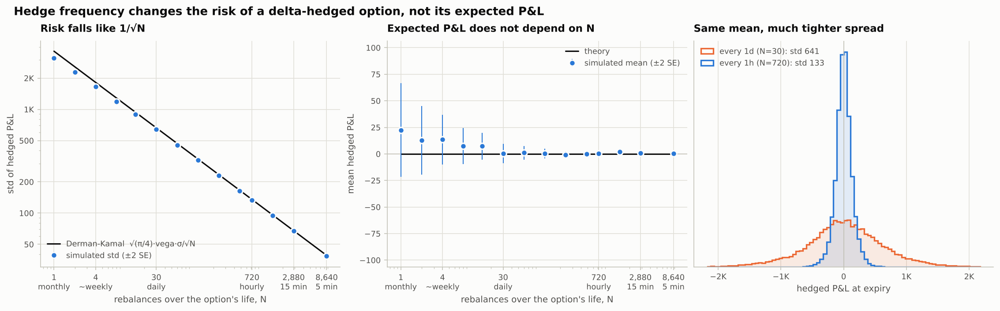
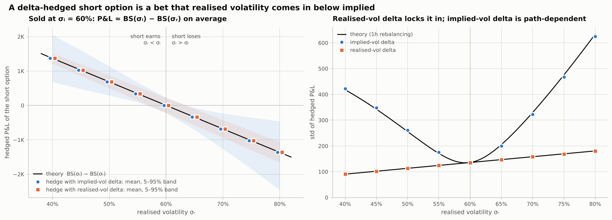
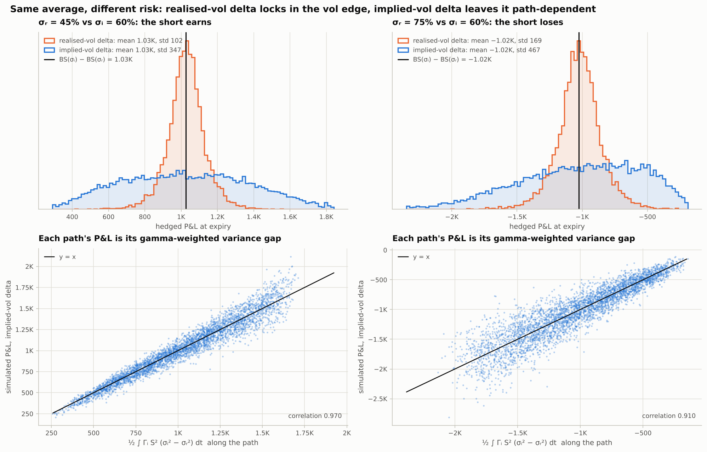
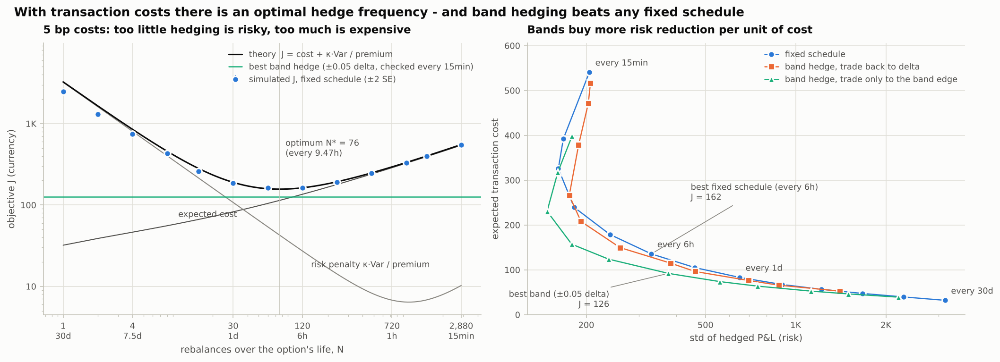
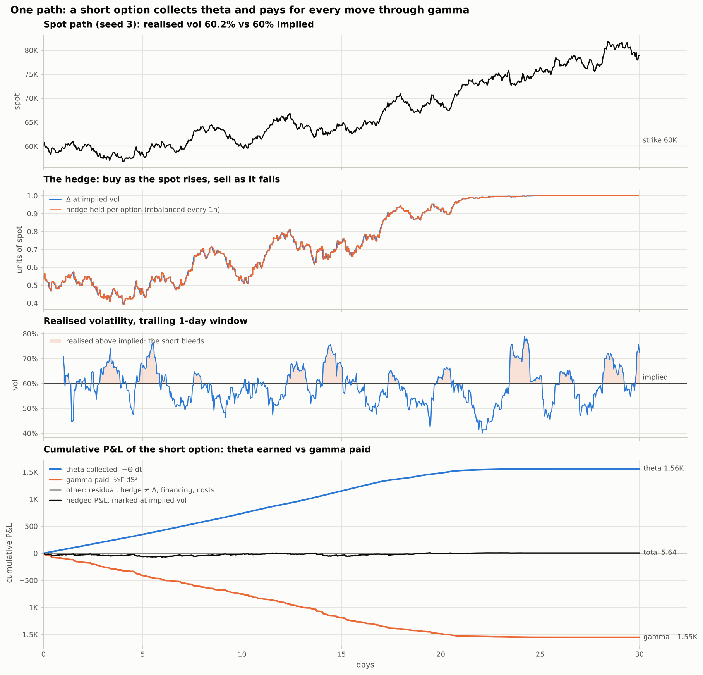
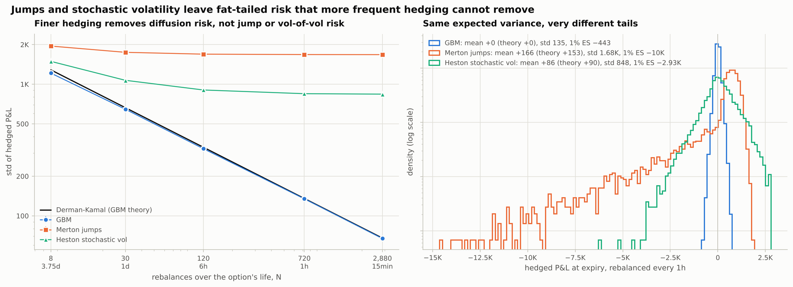

# Delta-hedging simulator

Sell an option, delta-hedge it on simulated price paths, and account for every dollar of the P&L.
Five experiments show **why hedging makes or loses money**: hedge frequency, realised vs implied
volatility, transaction costs, one path step by step, and what jumps and stochastic volatility do
to a Black-Scholes hedge. Closed-form theory is overlaid on every simulation and checked
automatically.

> **In one line:** a delta-hedged short option is a bet that realised volatility comes in below
> implied. Hedge frequency sets how noisy that bet is, costs set how often you can afford to
> hedge, and jumps and vol-of-vol are the risks no hedging frequency removes.

```bash
pip install -e ".[dev]"
python -m dhsim all          # all five experiments -> charts, tables and checks in output/ (~2 min)
pytest                       # 94 tests, ~30 s
```

## Setup

| | Default (crypto-like; every value configurable in [`configs/default.yaml`](configs/default.yaml)) |
|---|---|
| **Option** | 30-day at-the-money European call, strike 60,000; puts and any strike/expiry supported |
| **Market** | spot 60,000, interest rate *r* = 0, dividend/funding yield *q* = 0, 365-day year (24/7 trading) |
| **Trade** | at *t* = 0 **sell** one option at the Black-Scholes price with implied vol σᵢ = 60% |
| **Paths** | GBM with realised vol σᵣ (exact simulation); optional Merton jumps and Heston stochastic vol |
| **Hedge** | hold *h* = Δ units of spot, with Δ computed at σᵢ (default) or σᵣ; rebalance on a fixed schedule (monthly → weekly → daily → hourly → every *N* minutes) or only when \|Δ − *h*\| exceeds a band |
| **Cash** | the cash account accrues at *r*, the hedge earns the yield *q*, and each trade pays proportional costs (bp of notional) plus an optional fixed fee |
| **Expiry** | the option settles in cash and the hedge is unwound at *S_T* |

Every path gets an exact attribution:

$$\text{PnL} = \underbrace{V_0}_{\text{premium}} \; \underbrace{-\,\text{payoff}(S_T)}_{\text{payoff}} \; + \underbrace{\textstyle\sum_k h_k\,(S_{k+1}-S_k)}_{\text{hedge P\&L}} + \text{financing} - \text{costs}.$$

The total is the final cash-account balance. A test checks it against an independent, scalar
implementation of the cash account under rates, carry, costs, puts and band hedging. Marking the
option at σᵢ also splits every step into **theta**, **gamma**, hedge-vs-Δ mismatch, financing,
costs and a third-order residual.

## The key equations

**Gamma vs theta.** Mark the option at σᵢ. Over a step *dt* in which the spot moves by *dS*
(return *R* = *dS*/*S*), the delta-hedged *short* option earns (with *r* = *q* = 0)

$$d\Pi \;=\; -\big(dV - \Delta\,dS\big) \;=\; \underbrace{-\Theta\,dt}_{\text{theta: earned}} \;\; \underbrace{-\tfrac12\Gamma\,dS^2}_{\text{gamma: paid}} \;+\; O(dS^3) \;=\; \tfrac12\,\Gamma S^2\big(\sigma_i^2\,dt - R^2\big) + O(dS^3),$$

because the Black-Scholes PDE gives Θ = −½σᵢ²S²Γ. If the path realises volatility σᵣ, then
E[*R*²] = σᵣ² *dt*. Summed over the option's life, with continuous hedging at the σᵢ-delta
(El Karoui, Jeanblanc-Picqué & Shreve 1998):

$$\text{PnL} \;=\; \tfrac12\int_0^T \Gamma_t S_t^2\,\big(\sigma_i^2-\sigma_r^2\big)\,dt .$$

**Variance of discrete hedging.** Rebalancing *N* times (Δ*t* = *T*/*N*), each step's error
½ΓS²(σ²Δ*t* − *R*²) has mean zero and variance ½(ΓS²)²σ⁴Δ*t*². The errors are uncorrelated, so

$$\operatorname{Var}[\text{PnL}] \;\approx\; \tfrac12\,\sigma^4\,\Delta t\int_0^T E\big[(\Gamma_t S_t^2)^2\big]\,dt \;\propto\; \frac1N,
\qquad \text{std} \;\approx\; \sqrt{\frac{\pi}{4}}\;\frac{\text{vega}\cdot\sigma}{\sqrt N}\quad\text{(at the money: Derman \& Kamal)} .$$

**Vol gap, two hedges.** The σᵣ-delta replicates the option, so it locks in
BS(σᵢ) − BS(σᵣ) on every path. The σᵢ-delta earns the same on average (when the drift is
*r* − *q*), but path by path, through the integral above.

**Costs.** Each rebalance trades about Γ|Δ*S*| units of spot, so the expected cost is
*k*·√(2/π)·σ·√Δ*t*·Σ E[ΓS²] ∝ √*N* (Leland 1985), while the variance falls like 1/*N*.

[`theory.py`](src/dhsim/theory.py) evaluates all of these with three Gaussian integrals,
solved in closed form under GBM: E[S²Γ], E[(S²Γ)²] and the two-date E[S²Γ(*s*)·S²Γ(*t*)].
The theory curves on the charts are therefore exact integrals of the leading-order expansions,
for any strike, drift, *r*, *q* and hedge vol. They are not fitted curves.

## Results

All numbers below come from `python -m dhsim all` with the defaults (premium **4,112** for a
short 60%-vol 30-day ATM call on 60,000). Each experiment writes a PNG, a CSV table and a JSON
summary to [`output/`](output/), and [`output/checks.md`](output/checks.md) lists every
simulation-vs-theory check.

### 1. Hedge frequency: risk falls like 1/√N, expected P&L stays put

`python -m dhsim frequency --sigma-i 0.6 --sigma-r 0.6 --paths 20000`



With σᵣ = σᵢ the option is fairly priced, so the mean P&L is zero at *every* frequency. The
discounted hedge gains are martingale increments: discretisation adds noise, not drift. The std
falls from 3,114 (one static hedge) to 641 (daily), 133 (hourly) and 39 (every 5 minutes). It
follows Derman-Kamal within 3.5% for N ≥ 30, and a log-log fit gives a slope of −0.495.
Quadrupling the hedge frequency halves the risk.

| rebalancing | N | mean ± SE | std | Derman-Kamal | sim / theory |
|---|---:|---:|---:|---:|---:|
| monthly (static) | 1 | +22 ± 22 | 3,114 | 3,636 | 0.86 |
| ~weekly | 4 | +14 ± 12 | 1,660 | 1,818 | 0.91 |
| daily | 30 | +0.2 ± 4.5 | 641 | 664 | 0.97 |
| hourly | 720 | +0.6 ± 0.9 | 133 | 135 | 0.98 |
| every 15 min | 2,880 | +0.8 ± 0.5 | 67.5 | 67.7 | 1.00 |
| every 5 min | 8,640 | +0.5 ± 0.3 | 38.6 | 39.1 | 0.99 |

> **Flagged on purpose:** at 1–8 rebalances the simulated std is 7–14% *below* Derman-Kamal.
> The formula is leading order in 1/*N*, and a hedge left alone for a week is far from that
> regime. A static hedge's P&L is the hockey-stick payoff minus a straight line in *S_T*, not a
> sum of many small errors, and its spread is smaller than the 1/√N rule extrapolates. The
> checks report this deviation rather than hide it.

### 2. Realised vs implied: a delta-hedged short option is short volatility

`python -m dhsim volgap --sigma-i 0.6 --sigma-r 0.4:0.8:0.05`



The short earns when σᵣ < σᵢ and loses when σᵣ > σᵢ. Its mean P&L sits on BS(σᵢ) − BS(σᵣ)
for both hedges (all |z| < 1.2). The difference is risk. The realised-vol delta locks in the
vol edge with only discretisation noise, matching theory within 0.3%. The implied-vol delta
earns the same edge path by path, with a std 2–5× larger, also matching the closed-form theory
within 2.8%.



The bottom row shows each path's P&L under the implied-vol delta against its own
½∫ΓS²(σᵢ² − σᵣ²)*dt*. The two line up, and the scatter around the diagonal is exactly the
discrete-hedging error predicted in experiment 1 (within 1.5%). The vol-gap P&L depends on how
much *dollar gamma* the path held while the gap was realised, so the same 15-vol gap between
implied and realised makes very different amounts on different paths.

| σᵣ | BS(σᵢ) − BS(σᵣ) | implied-vol delta: mean / std (theory std) | realised-vol delta: mean / std (theory std) |
|---:|---:|---:|---:|
| 40% | +1,368.9 | +1,370.0 / 422 (418) | +1,369.8 / 90.4 (90.6) |
| 50% | +684.1 | +685.3 / 261 (256) | +685.3 / 112.9 (113.1) |
| 60% | 0.0 | +1.5 / 135.5 (135.7) | +1.5 / 135.5 (135.7) |
| 70% | −683.3 | −681.3 / 322 (330) | −681.5 / 157.8 (158.1) |
| 80% | −1,365.5 | −1,363.2 / 624 (633) | −1,363.4 / 180.0 (180.6) |

### 3. Transaction costs: an optimal hedge frequency, and bands beat schedules

`python -m dhsim costs --bps 5`



With 5 bp proportional costs and the objective *J* = −E[PnL] + κ·Var[PnL]/premium (κ = 1),
expected cost grows like √N and variance falls like 1/N. The trade-off is U-shaped.
Theory puts the optimum at **N\* = 76 (every ~9.5 h)**, J\* = 157. The simulation is flat
between every 12 h and every 6 h (J = 163 and 162), and expected costs match Leland-style theory
within 2.4% at every N. Hedging every 15 minutes costs 541 on average and leaves *more* risk
than hedging every 45 minutes (std 205 vs 161). Costs are path-dependent (paths that stay near
the strike hold more gamma and trade more), so their variance grows like N, and the
theory captures this too (std within 2.2%). **Band hedging** beats every fixed schedule:
re-hedging only when Δ drifts ±0.05 from the hedge, and only back to the band edge, gets
J = 126, **22% lower** than the best schedule.

| strategy | E[cost] (theory) | std of P&L (theory) | J (theory) |
|---|---:|---:|---:|
| every 1 d | 83.1 (82.4) | 650 (665) | 185.0 (190.0) |
| every 12 h | 105.1 (104.5) | 461 (471) | 163.2 (158.4) |
| every 6 h | 135.6 (135.4) | 330 (335) | 161.9 (162.7) |
| every 1.5 h | 239.6 (240.1) | 182 (184) | 245.0 (248.3) |
| every 15 min | 540.8 (542.5) | 205 (205) | 549.8 (552.7) |
| band ±0.05 Δ, trade to edge, checked every 15 min | 92.1 | 376 | **126.3** |

### 4. One path, step by step

`python -m dhsim path --seed 3`



On this path the spot rallies from 60,000 to 78,910. The call expires deep in the money with a
payoff of 18,910, more than 4× the 4,112 premium. The hedge bought spot as the price rose and
made +14,803, so the position finishes at **+5.6**. Underneath, the short collected **+1,560
of theta** and paid **−1,552 of gamma**. They nearly cancel because the path realised 60.2% vol
against 60% implied. The third-order residual is −1.6. Theta stops accruing once the option is
deep in the money and its gamma has gone.

### 5. Where the Black-Scholes hedge breaks: jumps and stochastic volatility

`python -m dhsim models`



All three models have the same expected realised variance, 60%² per year. Merton jumps arrive
5 times a year with log-size mean −5% and std 15%, and the diffusive vol is lowered to keep
total variance fixed. Heston has *v*₀ = θ = 0.36, κ = 3, ξ = 1.5, ρ = −0.3. Under GBM, finer
hedging keeps cutting the risk. Under Merton the std is **flat at ~1,680 from hourly to
15-minute hedging**, with skew −4 and a 1% expected shortfall of −10,043, 23× GBM's. A jump
moves the spot before the hedge can follow. Heston plateaus at ~845 because realised variance
itself is random. Both models show a *positive* mean for the short, and theory pins it down.
On risk-neutral paths the mean is BS(60%) minus the option's fair value in the model
(Merton series price 3,959; Heston Fourier price 4,023): **+153 and +90 predicted, +166 ± 17 and
+86 ± 9 simulated**. Fat tails make the ATM option worth less than Black-Scholes at the same
variance, so the short is paid a premium in calm paths and gives it back in the tail.

| hourly hedging | mean (theory) | std | skew | excess kurtosis | 1% ES | std: daily → hourly → 15 min |
|---|---:|---:|---:|---:|---:|---:|
| GBM | +0.2 (0) | 135 | −0.07 | 1.7 | −443 | 646 → 135 → 67 |
| Merton jumps | +166 (+153) | 1,681 | −3.96 | 21.0 | −10,043 | 1,748 → 1,681 → 1,678 |
| Heston | +86 (+90) | 848 | −0.36 | 2.0 | −2,928 | 1,071 → 848 → 841 |

## Does the simulation match the theory?

Every experiment checks itself and writes the results to [`output/checks.md`](output/checks.md).
Means are tested with a Bonferroni-corrected *z* threshold, a family-wise false-flag rate of 1%
across the frequencies or vols swept. Out of 26 checks, 25 pass:

| check | result |
|---|---|
| mean P&L = BS(σᵢ) − BS(σᵣ) at every frequency and vol, both hedges | ✅ largest \|z\| = 3.1 across 14 correlated frequencies (threshold 3.38); 8 further seeds (160k paths) give a pooled z of −0.35, so no bias |
| std vs Derman-Kamal / leading-order theory, N ≥ 30 | ✅ within 3.5% (frequency), 2.2% (with costs), 2.7% (models) |
| std of each hedge vs closed-form theory across σᵣ | ✅ within 0.3% (realised-vol delta) and 2.8% (implied-vol delta) |
| σᵢ-delta P&L − ½∫ΓS²(σᵢ² − σᵣ²)*dt* = discretisation error | ✅ within 1.5% |
| expected costs vs Leland-style theory | ✅ within 2.4% at every N |
| optimal N: simulation vs theory | ✅ theory N\* = 76 falls within the simulated optimum's grid neighbours (60–240); *J* within 3.4% |
| attribution and theta/gamma split sum to the total P&L | ✅ to 1e-11 |
| mean P&L under jumps / stochastic vol = BS(σᵢ) − model price (Merton series, Heston Fourier) | ✅ largest \|z\| = 1.7 across 3 models × 5 frequencies |
| jump / stochastic-vol risk plateaus with hedge frequency | ✅ std falls to 99–100% from hourly to 15-min (GBM: 50%) |
| std vs Derman-Kamal, **N < 30** | ⚠️ **flagged**: sim/theory 0.86–0.93 (leading-order formula, see experiment 1) |

## Interview talking points

**Why a delta-hedged short option is a short-volatility bet.**
- The delta hedge removes the first-order exposure to direction. What is left is second order:
  every step the short collects ½ΓS²σᵢ²*dt* (theta) and pays ½ΓS²*R*² (gamma). Net, it earns
  ½ΓS²(σᵢ²*dt* − *R*²), so it wins whenever the realised squared move is smaller than what
  implied vol priced in.
- Summed up, PnL ≈ ½∫ΓS²(σᵢ² − σᵣ²)*dt*: short realised variance, weighted by dollar gamma.
  Sold at 60% and realised at 45%, the short makes +1,027 ≈ BS(60%) − BS(45%). Realised at
  75%, it loses about 1,024.
- The breakeven daily move is S·σ·√(1/365) = 1,884, or 3.1% of spot. A bigger move in a day
  costs the short more in gamma than it earned in theta.
- Gamma is concentrated near the strike and near expiry, so *when* and *where* volatility shows
  up matters. A 5% move at the strike on day 29 costs far more than the same move on day 1.

**Why hedge frequency changes risk but not expected P&L.**
- The expected P&L is the vol edge, BS(σᵢ) − BS(σᵣ), for *any* rebalancing schedule. Hedge
  gains are martingale increments, so discretisation adds noise, not drift (experiment 1:
  every mean within its error bars).
- Each step's error ½ΓS²(σ²Δ*t* − *R*²) is mean-zero with variance ∝ Δ*t*², so the total
  variance is ∝ 1/N and std ≈ √(π/4)·vega·σ/√N. Monthly → daily → hourly takes the std from
  3,114 to 641 to 133 on a 4,112 premium.
- Even under GBM the hedging error is fat-tailed (excess kurtosis ≈ 1.5–2). Paths pinned to the
  strike near expiry carry enormous gamma.

**The costs trade-off.**
- Costs grow like √N (each trade is ~Γ·|Δ*S*|, of size √Δ*t*) and variance falls like 1/N,
  so a mean-variance objective has an interior optimum N\* ∝ *k*^(−2/3). Here that is every
  ~9.5 hours at 5 bp, and hedging every 15 minutes costs 3.4× as much in *J*.
- Costs are random too. Paths that hang around the strike trade more, so cost variance grows
  like N, and beyond ~45-minute hedging the *total* risk rises again.
- Bands spend the trading budget where gamma is: trade only when |Δ − *h*| exceeds a band, and
  only back to its edge. That gave 22% better *J* than any fixed schedule here. Whalley &
  Wilmott (1997) show the optimal band width scales like (*k*SΓ²/risk-aversion)^(1/3).

**What breaks.**
- **Jumps:** a gap moves the spot before you can re-hedge, and the loss
  V(SJ) − V(S) − ΔS(J − 1) is locked in whatever the hedge frequency. Here the std is flat at
  ~1,680, the skew is −4 and the 1% ES is −10,000. Short options earn a premium in calm markets
  and give it back in jumps.
- **Vol of vol:** under Heston, realised variance is itself random. The vol-gap P&L
  ½∫ΓS²(σᵢ² − *v*ₜ)*dt* doesn't diversify away with more rebalancing; the std plateaus at ~845.
- **Wrong-vol delta:** the realised-vol delta locks in the edge only if you know σᵣ. The
  implied-vol delta is the practical default, and it carries path-dependent P&L: std 347 vs
  102 at σᵣ = 45%. Under skew or spot-vol correlation, neither is the minimum-variance hedge.
- **The model mark:** with jumps or stochastic vol, the ATM option is worth less than
  Black-Scholes at the same total variance (Merton 3,959 and Heston 4,023 vs 4,112). The
  short's positive mean (+153 and +90 in theory, matched by the simulation) is payment for
  tail risk, not free money.

## Using the code

```bash
python -m dhsim frequency --sigma-i 0.6 --sigma-r 0.6 --paths 20000
python -m dhsim frequency --steps weekly,daily,1h,15min      # intervals or counts
python -m dhsim volgap --sigma-i 0.6 --sigma-r 0.4:0.8:0.05 --steps 1d
python -m dhsim costs --bps 5 --bands 0.01,0.02,0.05 --risk-aversion 2
python -m dhsim path --seed 3 --sigma-r 0.8 --every 24       # daily rebalancing on an hourly path
python -m dhsim models --lam 10 --jump-std 0.1
python -m dhsim price --sigma-i 0.6 --strike 65000           # price, Greeks, breakeven move
python -m dhsim all --config my.yaml --strict                # exit 1 if any check is flagged
```

Every flag overrides the YAML config (copy [`configs/default.yaml`](configs/default.yaml)).
Puts, any strike, rates, a funding yield, a real-world drift, long positions (`--position 1`)
and fixed per-trade fees are all supported. The library can be used directly:

```python
import numpy as np
from dhsim.hedging import Market, Option, Strategy, Costs, run_hedge
from dhsim.paths import GBM

paths = GBM(0.45).simulate(60_000, 30 / 365, n_steps=720, n_paths=10_000,
                           rng=np.random.default_rng(0))
res = run_hedge(paths.S, paths.t, Option(60_000, 30 / 365, "call", -1), Market(60_000),
                sigma_i=0.6, strategy=Strategy(hedge_vol=0.45), costs=Costs(bps=5),
                decompose=True)
res.pnl.mean(), res.attribution(), res.decomposition()
```

## Repository layout

```
src/dhsim/
  bs.py            Black-Scholes price, delta, gamma, vega, theta (vectorised; T=0 and sigma=0 limits)
  paths.py         GBM (exact), Merton jump-diffusion, Heston (full-truncation Euler)
  hedging.py       the hedging engine: schedules, bands, costs, financing, attribution
  theory.py        dollar-gamma moments, Derman-Kamal, vol-gap, cost and variance formulas, Merton and Heston prices
  experiments/     the five experiments (one module each) behind the CLI
  cli.py           python -m dhsim ...
tests/             pytest suite (Black-Scholes, paths, engine, theory, config, CLI)
notebooks/         walkthrough.ipynb: the whole story with small simulations, executed
output/            charts (PNG), tables (CSV), summaries (JSON) and checks.md from `dhsim all`
configs/           default.yaml
```

**Tests** (`pytest`, 94 tests) cover:
- Black-Scholes prices vs Monte Carlo within 3 SE, put-call parity, Greeks vs finite
  differences, the BS PDE, and T = 0 / σ = 0 limits.
- σᵣ = σᵢ with fine hedging: mean ≈ 0 and std → small, scaling as 1/√N.
- σᵣ-delta P&L ≈ BS(σᵢ) − BS(σᵣ) with low dispersion, and the mean equal to that gap for any
  hedge.
- The attribution identity against an independent cash-account loop on every path.
- Exact replication on zero-vol paths.
- The closed forms against Monte Carlo, and the theory against the engine.

## References

- F. Black & M. Scholes, "The pricing of options and corporate liabilities", *Journal of Political Economy* 81 (1973); R. C. Merton, "Theory of rational option pricing", *Bell Journal of Economics* 4 (1973).
- E. Derman & M. Kamal, "When you cannot hedge continuously: the corrections of Black-Scholes", Goldman Sachs Quantitative Strategies Research Notes (1998); a version appeared in *Risk* (1999). Source of std ≈ √(π/4)·vega·σ/√N.
- N. El Karoui, M. Jeanblanc-Picqué & S. Shreve, "Robustness of the Black and Scholes formula", *Mathematical Finance* 8(2) (1998).
- R. Ahmad & P. Wilmott, "Which free lunch would you like today, Sir? Delta hedging, volatility arbitrage and optimal portfolios", *Wilmott Magazine* (2005).
- H. Leland, "Option pricing and replication with transactions costs", *Journal of Finance* 40(5) (1985).
- A. E. Whalley & P. Wilmott, "An asymptotic analysis of an optimal hedging model for option pricing with transaction costs", *Mathematical Finance* 7(3) (1997).
- R. C. Merton, "Option pricing when underlying stock returns are discontinuous", *Journal of Financial Economics* 3 (1976).
- S. Heston, "A closed-form solution for options with stochastic volatility with applications to bond and currency options", *Review of Financial Studies* 6(2) (1993).
- H. Albrecher, P. Mayer, W. Schoutens & J. Tistaert, "The little Heston trap", *Wilmott Magazine* (2007): the numerically stable characteristic function used for the Heston price.
- R. Lord, R. Koekkoek & D. van Dijk, "A comparison of biased simulation schemes for stochastic volatility models", *Quantitative Finance* 10(2) (2010).
